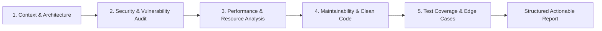

# Code Review & Quality Assurance Skill

This skill guides the agent through systematic, high-rigor code reviews. It covers correctness, security vulnerabilities, performance bottlenecks, code quality/maintainability, and test coverage.

## Review Methodology

When performing a code review, follow this 5-stage analytical process:



---

## 1. Security & Vulnerability Checklist

### A. Injection & Sanitization
- [ ] **SQL / NoSQL Injection**: Ensure all queries use parameterized inputs, ORM query builders, or prepared statements. Never concatenate raw strings into queries.
- [ ] **XSS (Cross-Site Scripting)**: Verify that user inputs rendered in HTML/JSX are sanitized or escaped. Check `dangerouslySetInnerHTML`, raw HTML injection, or unsanitized markdown renderers.
- [ ] **Command / Shell Injection**: Verify that any system execution uses safe argument lists rather than shell string interpolation.
- [ ] **Path Traversal**: Validate and sanitize file paths coming from user parameters (prevent `../` traversal).

### B. Authentication & Authorization
- [ ] **Access Control**: Validate that permissions/roles are checked at the server boundary (middleware / API route / RPC) and not solely on the client.
- [ ] **Secrets & Sensitive Data**: Check that API keys, private tokens, passwords, and connection strings are NOT committed to source files. Ensure they are loaded from environment variables.
- [ ] **CORS & CSRF**: Confirm CORS headers are appropriately restricted and state-modifying POST/PUT/DELETE requests implement CSRF protections where applicable.

### C. Resource Safety & Cryptography
- [ ] **ReDoS (Regular Expression Denial of Service)**: Check regex patterns for catastrophic backtracking on untrusted inputs.
- [ ] **Prototype Pollution**: Validate object merging / cloning functions against `__proto__` and `constructor` injections.
- [ ] **Cryptographic Primitives**: Ensure secure random generators (`crypto.getRandomValues`, `crypto.randomBytes`) and modern hashing algorithms (Argon2, bcrypt, SHA-256) are used.

---

## 2. Performance & Bottleneck Analysis

### A. Runtime & Compute
- [ ] **Algorithmic Complexity**: Identify $O(n^2)$ or worse loops, repeated searches over unindexed arrays (prefer `Set`/`Map` lookups).
- [ ] **Unnecessary Re-computations**: Look for heavy calculations executed inside render cycles or repeated loops without memoization.
- [ ] **Memory Leaks**: Identify uncleaned event listeners, intervals/timeouts, dangling subscriptions, or unbounded in-memory caches.

### B. Asynchronous & Network I/O
- [ ] **Waterfall Requests**: Replace sequential `await` calls that are independent with `Promise.all` or `Promise.allSettled`.
- [ ] **N+1 Queries**: Identify database queries executed inside loops instead of batch fetches or relational joins.
- [ ] **Payload Overhead**: Check for oversized JSON payloads, missing pagination, or missing compression.

---

## 3. Code Maintainability & TypeScript Standards

### A. Type Safety & Clarity
- [ ] **Strict Typing**: Avoid `any` types. Use explicit interfaces, generic constraints, or `unknown` with type guards.
- [ ] **Discriminated Unions**: Verify state and action objects use discriminated unions for exhaustiveness checking.
- [ ] **Immutability**: Avoid mutating parameters or global states in place.

### B. Clean Code & Architecture
- [ ] **Single Responsibility Principle (SRP)**: Ensure functions and components do one clear job. Break down 200+ line functions.
- [ ] **Error Handling**: Verify every promise or error-prone block has clear error handling, structured logging, and fallback states.
- [ ] **Naming & Readability**: Ensure variable and function names convey explicit business intent without misleading abbreviations.

---

## 4. Test Coverage & Edge Cases

### A. Edge Cases to Verify
- Nullish / Undefined inputs (`null`, `undefined`, empty string `""`, `0`, `NaN`, empty arrays `[]`, empty objects `{}`).
- Concurrency and race conditions (debouncing, abort controllers on fetch).
- Boundary values (min, max, off-by-one errors).
- Offline / Network failure states.

### B. Testing Best Practices
- Verify unit tests test behavior rather than implementation details.
- Ensure critical business logic and calculation routines have near 100% branch coverage.

---

## 5. Structured Review Output Format

Always format code reviews with this clear, prioritized structure:

```markdown
### 📋 Review Summary
- **Overall Quality**: [Excellent | Good | Needs Work | Critical Fixes Required]
- **Files Reviewed**: `[file list]`
- **Key Highlights**: Brief 1-2 sentence overview.

---

### 🚨 Critical / Security Findings
*(Issues requiring immediate fix prior to merge/production)*
- **[File:Line]**: Issue description.
  - **Risk**: Security exploit or fatal bug details.
  - **Fix**: Code diff showing the remediation.

---

### ⚠️ Performance & Architecture Improvements
*(Bottlenecks, re-renders, N+1 queries, typing issues)*
- **[File:Line]**: Issue description and suggested optimization.

---

### 💡 Minor Polish & Nitpicks
*(Naming, documentation, minor cleanups)*
- Suggestions for maintainability.

---

### ✅ Verification & Next Steps
- Recommended tests to run.
- Commands to validate fix: `npm test`, `npm run lint`, etc.
```
