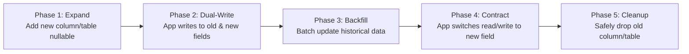

# Database Schema Validator & Migration Safety Skill

This skill provides procedural guidelines, safety checks, integrity validation, and performance audits for database schemas and production migrations across PostgreSQL, MySQL, SQLite, Supabase, Prisma, and Drizzle.

## Safe Migration Lifecycle (Expand & Contract)



---

## 1. Zero-Downtime Migration Safety Rules

### 🚨 Critical Anti-Patterns (Never Do in Single Step)
1. **Never rename columns in-place**: This immediately breaks running instances of the application during deployment rolling updates. Use the 5-phase Expand/Contract pattern.
2. **Never add a `NOT NULL` column without a safe default or two-phase backfill**:
   ```sql
   -- ❌ Dangerous on large production tables (locks table and rewrites)
   ALTER TABLE users ADD COLUMN bio TEXT NOT NULL;

   -- ✅ Safe Pattern (PostgreSQL 11+)
   ALTER TABLE users ADD COLUMN bio TEXT DEFAULT '' NOT NULL;
   ```
3. **Never create indexes synchronously on busy production tables**:
   ```sql
   -- ❌ Dangerous: Takes ACCESS EXCLUSIVE lock, blocking reads/writes
   CREATE INDEX idx_orders_user_id ON orders(user_id);

   -- ✅ Safe Pattern: Builds index without locking writes
   CREATE INDEX CONCURRENTLY idx_orders_user_id ON orders(user_id);
   ```

---

## 2. Schema Design & Data Integrity Checklist

### A. Primary & Foreign Keys
- [ ] **Primary Key Strategy**: Prefer time-sortable identifiers (**UUIDv7** or `BIGSERIAL` / `BIGINT`) over random UUIDv4 to avoid B-Tree page fragmentation on high-throughput tables.
- [ ] **Indexed Foreign Keys**: Ensure foreign key columns have dedicated indexes. Unindexed FKs cause full table scans on parent row updates or cascade deletes.
- [ ] **Cascade Rules**: Explicitly declare `ON DELETE RESTRICT` or `ON DELETE CASCADE` rather than relying on engine defaults.

### B. Constraints & Data Types
- [ ] **Timezones**: Always use `TIMESTAMPTZ` (timestamp with time zone) or ISO 8601 UTC timestamps. Avoid naive `TIMESTAMP`.
- [ ] **Monetary / Exact Values**: Always use `NUMERIC` / `DECIMAL` or integer cents for monetary calculations. Never use `FLOAT` or `REAL` due to precision rounding errors.
- [ ] **Check Constraints**: Enforce domain validation at the database level (e.g., `CHECK (price >= 0)`, `CHECK (status IN ('draft', 'published', 'archived'))`).

---

## 3. Indexing & Query Optimization Protocol

### A. Composite Index Column Ordering (ESR Rule)
When creating composite multi-column indexes, order columns by:
1. **E**quality filters (`status = 'active'`)
2. **S**ort criteria (`ORDER BY created_at DESC`)
3. **R**ange filters (`created_at >= '2026-01-01'`)

```sql
-- Query: WHERE team_id = 42 AND status = 'active' ORDER BY created_at DESC
-- Optimal Index:
CREATE INDEX CONCURRENTLY idx_team_status_created 
ON tasks (team_id, status, created_at DESC);
```

### B. Partial & Expression Indexes
Reduce index storage and RAM overhead by indexing only the hot query path:

```sql
-- Index only active subscriptions instead of millions of expired rows
CREATE INDEX CONCURRENTLY idx_active_subscriptions 
ON subscriptions (user_id) 
WHERE status = 'active';
```

---

## 4. Migration Execution & Safety Protocol

Before proposing or executing any database migration script, execute this audit checklist:

```markdown
### 🛡️ Migration Safety Audit Checklist
1. **Lock Duration Assessment**:
   - Will this DDL hold an `ACCESS EXCLUSIVE` lock for $> 100\text{ms}$?
   - Is `SET lock_timeout = '2s';` specified to avoid blocking connection pools?
2. **Reversibility / Rollback Plan**:
   - Is there a corresponding `down` migration script?
   - Can this migration be rolled back without data loss?
3. **Application Compatibility**:
   - Does this migration require old code to be running simultaneously during zero-downtime rolling deploys?
4. **Data Backfill Strategy**:
   - Are batch limits used (e.g., updating 1,000 rows per batch with sleep) for large tables ($> 100,000$ rows)?
```
