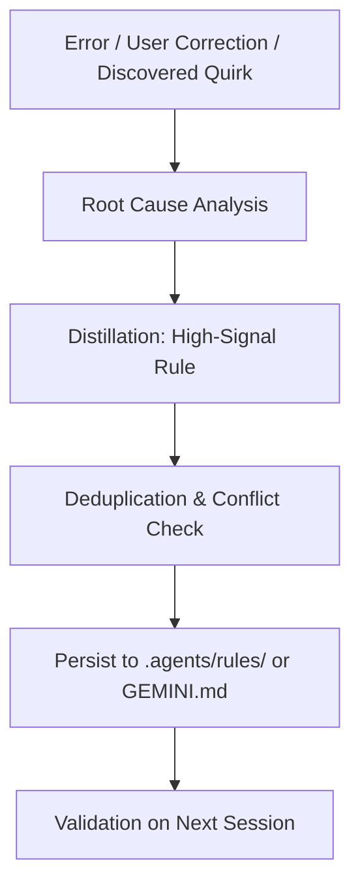

# Self-Improving Agent & Memory Synthesis Skill

This skill defines the runtime feedback loop for capturing learnings, handling user corrections, debugging post-mortems, and synthesizing actionable rules directly into the workspace's persistent memory.

## Continuous Learning Lifecycle



---

## 1. Trigger Detection

Activate this learning process whenever one of the following occurs:
1. **User Correction**: The user corrects an assumption, stylistic preference, architectural pattern, or tool usage.
2. **Build / Test Failure Recovery**: An obscure error or framework quirk was resolved after non-trivial troubleshooting.
3. **Environment Idiosyncrasy**: A specific port, path convention, package manager (e.g., `pnpm` vs `npm`), or script command is required for the workspace.
4. **Design / Protocol Decision**: A consensus is reached on API contracts, naming conventions, or component architectures.

---

## 2. Rule Distillation Criteria

To prevent memory bloat, all captured rules must pass the **Signal-to-Noise Filter**:

| Pass Criteria (Record This) | Fail Criteria (Discard This) |
| :--- | :--- |
| Project-specific conventions (e.g. "Always use `pnpm` in this repo"). | Universal generic knowledge (e.g. "JavaScript is dynamically typed"). |
| Framework quirks (e.g. "Astro client:visible needed for modal portals"). | Obvious syntax errors or one-time typos. |
| User architectural constraints (e.g. "Do not use Redux; use Zustand"). | Overly broad platitudes (e.g. "Write good code"). |
| Security/Safety boundaries (e.g. "Never execute raw migration without backup"). | Transient debugging state. |

---

## 3. Storage Hierarchy & Organization

Rules must be stored in the appropriate customization location:

```text
<workspace_root>/
├── .agents/
│   ├── rules/
│   │   ├── styling.md           # CSS, Tailwind, Design tokens
│   │   ├── architecture.md      # Next.js / React / Astro boundaries
│   │   ├── testing.md           # Test requirements, mock policies
│   │   └── tooling.md           # pnpm, Docker, CI/CD scripts
│   └── skills/                  # Procedural workflows
├── GEMINI.md                    # Project-level overview & primary rules
└── AGENTS.md                    # Workspace conventions
```

---

## 4. Rule Template & Format

When synthesizing a new rule into `.agents/rules/<topic>.md` or updating memory, use this structure:

```markdown
<!-- rule: unique-slug-identifier -->
### [Rule Title]

**Context**: Why this rule exists (the failure or user preference that triggered it).
**Constraint**:
- MUST: Explicit requirement.
- MUST NOT: Explicit prohibition.

```typescript
// ❌ Incorrect / Anti-pattern
const bad = ...;

// ✅ Correct Pattern
const good = ...;
```
```

---

## 5. Execution Runbook: Capturing a Lesson

When instructed to record a lesson or when resolving a critical workflow correction:

1. **Synthesize the Lesson**:
   - What failed or what was requested?
   - What is the exact root cause?
   - What is the concise, permanent directive?
2. **Inspect Existing Rules**:
   - View `.agents/rules/` or `GEMINI.md`.
   - Check if an existing rule contradicts or overlaps with the new rule.
3. **Update or Create Rule**:
   - If an existing rule file matches the domain, append the rule using `replace_file_content` or `multi_replace_file_content`.
   - If it represents a new domain, create `.agents/rules/<domain>.md`.
4. **Notify the User**:
   - Confirm concisely: "Persistent memory updated in `.agents/rules/<domain>.md`: `[summary of rule]`".
