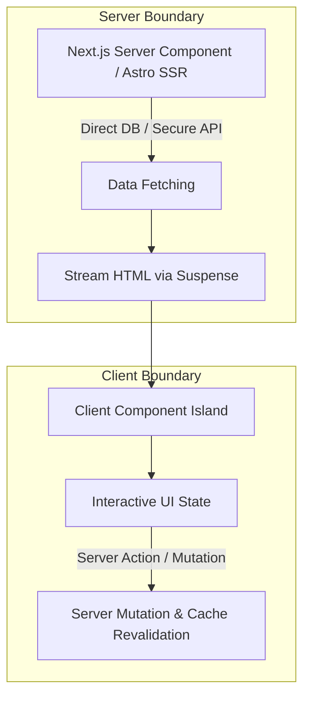

# Senior Frontend Engineering & Modern Architecture Skill

This skill provides expert engineering patterns, architectural paradigms, performance optimizations, and best practices for building scalable applications with React, Next.js, Astro, TypeScript, and modern state management ecosystems.

## Mental Model & Core Architecture



---

## 1. Server vs. Client Component Boundaries

### A. The "Leaves-Only" Client Component Rule
Keep `'use client'` pushed as far down the component tree as possible. 
- Fetch data in Server Components.
- Pass static markup or children slots from Server Components into Client Components.

```tsx
// ✅ Recommended: Server component passes interactive payload or children
import { InteractiveModal } from './interactive-modal';
import { db } from '@/lib/db';

export default async function ProductPage({ params }: { params: { id: string } }) {
  const product = await db.product.findUnique({ where: { id: params.id } });

  return (
    <main className="container mx-auto px-4 py-8">
      <h1>{product.title}</h1>
      <p>{product.description}</p>
      
      {/* Client island only wraps the interactive action */}
      <InteractiveModal productId={product.id}>
        <div className="p-4 bg-surface-elevated rounded-lg">
          <p>Read reviews and specs directly from server markup.</p>
        </div>
      </InteractiveModal>
    </main>
  );
}
```

### B. Server Actions & Form Mutations
Use progressive enhancement, `useActionState`, and `useTransition` for smooth, non-blocking UI updates:

```tsx
'use client';

import { useActionState } from 'react';
import { updateProfile } from '@/actions/profile';

export function ProfileForm({ user }: { user: User }) {
  const [state, formAction, isPending] = useActionState(updateProfile, { error: null });

  return (
    <form action={formAction} className="space-y-4">
      <input defaultValue={user.name} name="name" required className="input" />
      {state.error && <p className="text-status-error text-sm">{state.error}</p>}
      <button type="submit" disabled={isPending} className="btn-primary">
        {isPending ? 'Saving...' : 'Save Profile'}
      </button>
    </form>
  );
}
```

---

## 2. State Management Hierarchy

Never store everything in a global store or monolithic context. Segment state by its natural lifetime:

| State Layer | Recommended Tool | Purpose & Characteristics |
| :--- | :--- | :--- |
| **URL State** | `nuqs` / `useSearchParams` | Filters, pagination, tabs, modal query states (shareable, bookmarkable, preserves history). |
| **Server Cache** | Next.js `fetch` / TanStack Query | Asynchronous remote data, caching, deduplication, background polling, revalidation. |
| **Global Client UI** | `zustand` | Modals, sidebar collapse state, user preferences, audio player status. |
| **Local Component UI**| `useState` / `useReducer` | Form inputs, dropdown open states, component-scoped animations. |

### Rule: Avoid Derived State in `useState`
Never copy props into state unless you want an isolated, detached draft. Derive state inline or with `useMemo`:

```tsx
// ❌ Anti-pattern: Syncing props into state with useEffect
const [filteredItems, setFilteredItems] = useState(items);
useEffect(() => {
  setFilteredItems(items.filter(i => i.active));
}, [items]);

// ✅ Senior Pattern: Compute derived values during render
const filteredItems = useMemo(() => items.filter(i => i.active), [items]);
```

---

## 3. TypeScript & Type Safety Architecture

### A. Discriminated Unions for Async UI States
Eliminate impossible states (e.g. `isLoading: true` and `error: Error` simultaneously):

```typescript
export type AsyncState<T> =
  | { status: 'idle'; data: null; error: null }
  | { status: 'loading'; data: null; error: null }
  | { status: 'success'; data: T; error: null }
  | { status: 'error'; data: null; error: Error };
```

### B. Runtime Boundary Validation with Zod
Validate all external inputs (API payloads, route params, search params, form submissions):

```typescript
import { z } from 'zod';

export const SearchParamsSchema = z.object({
  query: z.string().default(''),
  page: z.coerce.number().int().positive().default(1),
  category: z.enum(['all', 'games', 'assets']).default('all'),
});

export type SearchParams = z.infer<typeof SearchParamsSchema>;
```

---

## 4. Web Performance & Core Web Vitals Optimization

### A. LCP (Largest Contentful Paint) < 2.5s
- Preload above-the-fold hero images with `priority` attribute or `<link rel="preload">`.
- Use zero-layout-shift fonts (`next/font/google` or `font-display: swap` with size-adjust fallbacks).
- Avoid client-side waterfalls before rendering the main hero section.

### B. INP (Interaction to Next Paint) < 200ms
- Offload non-urgent state updates with `startTransition` or `useDeferredValue`.
- Avoid heavy JavaScript tasks blocking the main thread ($> 50\text{ms}$).
- Debounce high-frequency events (window resize, search keystrokes, scroll position).

### C. CLS (Cumulative Layout Shift) < 0.1
- Always specify `width` and `height` or `aspect-ratio` on images, videos, and dynamic embeds.
- Ensure skeleton loaders have the exact dimensional geometry of loaded content.
- Reserve space for dynamic ads or banners.

---

## 5. Architectural Checklist for Senior Code Reviews

- [ ] **Component Cohesion**: Is the component doing too much? Extract custom hooks for logic and sub-components for presentation.
- [ ] **Rendering Efficiency**: Are heavy child components wrapped in memo or separated into distinct sub-trees to prevent unnecessary re-renders?
- [ ] **Error Boundaries**: Are Suspense boundaries and Error Boundaries placed granularly around async widgets so failure doesn't crash the entire page?
- [ ] **Tree-shaking & Bundles**: Are massive icon libraries or utility libraries imported with deep imports rather than entire barrel files?
- [ ] **Accessibility**: Are semantic markup, keyboard navigation, and ARIA roles completely implemented?
