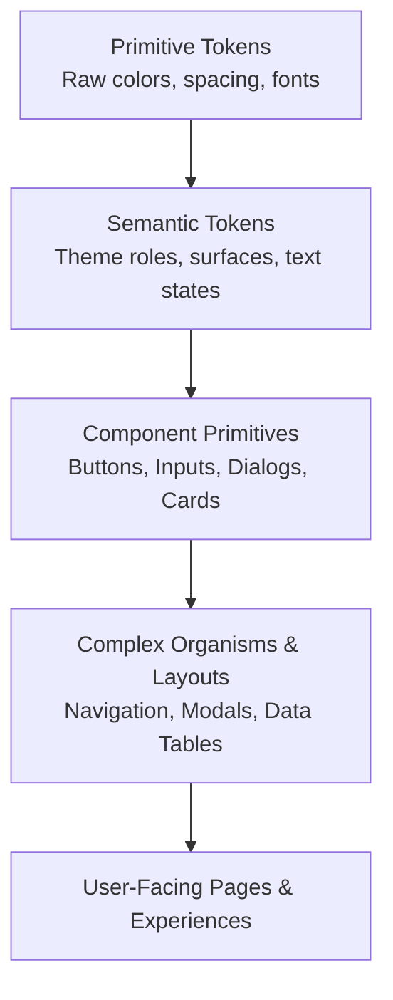

# UI Design System & Component Engineering Skill

This skill guides the design, generation, and strict enforcement of UI Design Systems, Design Tokens, accessible component primitives, and aesthetic consistency across web applications.

## Design System Architecture



---

## 1. Design Token Architecture & Definition

### A. Semantic Token Structure
Never hardcode raw HEX codes or ad-hoc pixel values in components. Design tokens must be structured in two tiers:

1. **Primitive Layer**: Raw scale values (e.g., `slate-900`, `violet-500`, `4px`).
2. **Semantic Layer**: Functional roles tied to intent (e.g., `--surface-primary`, `--text-muted`, `--border-focus`).

```css
:root {
  /* Primitive Palette */
  --palette-slate-900: #0f172a;
  --palette-slate-800: #1e293b;
  --palette-slate-100: #f1f5f9;
  --palette-indigo-500: #6366f1;
  --palette-indigo-600: #4f46e5;
  --palette-rose-500: #f43f5e;

  /* Typography Scale */
  --font-family-sans: 'Inter', system-ui, -apple-system, sans-serif;
  --font-family-mono: 'JetBrains Mono', monospace;
  --text-xs: clamp(0.75rem, 0.7rem + 0.25vw, 0.8rem);
  --text-sm: clamp(0.875rem, 0.8rem + 0.35vw, 0.925rem);
  --text-base: clamp(1rem, 0.95rem + 0.25vw, 1.05rem);
  --text-lg: clamp(1.125rem, 1.05rem + 0.4vw, 1.25rem);
  --text-xl: clamp(1.25rem, 1.15rem + 0.6vw, 1.5rem);
  --text-2xl: clamp(1.5rem, 1.3rem + 1vw, 2rem);
  --text-3xl: clamp(1.875rem, 1.6rem + 1.4vw, 2.5rem);

  /* Spacing Scale (4px / 8px baseline) */
  --space-1: 0.25rem;  /* 4px */
  --space-2: 0.5rem;   /* 8px */
  --space-3: 0.75rem;  /* 12px */
  --space-4: 1rem;     /* 16px */
  --space-6: 1.5rem;   /* 24px */
  --space-8: 2rem;     /* 32px */
  --space-12: 3rem;    /* 48px */
  --space-16: 4rem;    /* 64px */

  /* Border Radii */
  --radius-sm: 0.375rem;
  --radius-md: 0.5rem;
  --radius-lg: 0.75rem;
  --radius-xl: 1rem;
  --radius-full: 9999px;

  /* Semantic Theme Tokens - Default (Dark / Cyber-Modern) */
  --bg-app: #090d16;
  --surface-base: #0f172a;
  --surface-elevated: #1e293b;
  --surface-overlay: rgba(15, 23, 42, 0.85);
  
  --border-subtle: rgba(255, 255, 255, 0.08);
  --border-strong: rgba(255, 255, 255, 0.18);
  --border-focus: #6366f1;

  --text-primary: #f8fafc;
  --text-secondary: #94a3b8;
  --text-muted: #64748b;
  --text-accent: #818cf8;

  --accent-primary: #6366f1;
  --accent-hover: #4f46e5;
  --accent-glow: rgba(99, 102, 241, 0.35);

  --status-success: #10b981;
  --status-warning: #f59e0b;
  --status-error: #f43f5e;
}
```

---

## 2. Component Engineering Standards

### A. Variant Composition Pattern
Use typed variant managers (e.g. `class-variance-authority` or strict token mapping) to handle sizes, variants, and states.

```typescript
import { cva, type VariantProps } from 'class-variance-authority';
import { clsx } from 'clsx';
import { twMerge } from 'tailwind-merge';

export const buttonVariants = cva(
  'inline-flex items-center justify-center font-medium transition-all duration-200 focus-visible:outline-none focus-visible:ring-2 focus-visible:ring-offset-2 disabled:pointer-events-none disabled:opacity-50 select-none',
  {
    variants: {
      variant: {
        primary: 'bg-indigo-600 text-white shadow-lg shadow-indigo-500/25 hover:bg-indigo-500 active:scale-[0.98]',
        secondary: 'bg-slate-800 text-slate-100 border border-slate-700/60 hover:bg-slate-700/80',
        ghost: 'text-slate-300 hover:bg-slate-800/60 hover:text-white',
        destructive: 'bg-rose-600 text-white shadow-lg shadow-rose-500/20 hover:bg-rose-500',
        glass: 'backdrop-blur-md bg-white/10 border border-white/15 text-white hover:bg-white/20'
      },
      size: {
        sm: 'h-8 px-3 text-xs rounded-md gap-1.5',
        md: 'h-10 px-4 text-sm rounded-lg gap-2',
        lg: 'h-12 px-6 text-base rounded-xl gap-2.5',
        icon: 'h-10 w-10 p-0 rounded-lg'
      }
    },
    defaultVariants: {
      variant: 'primary',
      size: 'md'
    }
  }
);
```

### B. Glassmorphism & Elevation Layering
- **Layer 0 (Canvas)**: `--bg-app`
- **Layer 1 (Card/Container)**: `--surface-base` + border subtle.
- **Layer 2 (Hover/Dropdown/Popover)**: `--surface-elevated` + shadow-lg.
- **Layer 3 (Modal/Sheet Backdrop)**: `backdrop-blur-md` + `--surface-overlay`.

---

## 3. Accessibility (WCAG 2.1 AA) Compliance Checklist

1. **Color Contrast**:
   - Normal text ($< 18\text{pt}$ or $< 14\text{pt}$ bold): Minimum contrast ratio **$4.5:1$** against background.
   - Large text ($\ge 18\text{pt}$ or $\ge 14\text{pt}$ bold): Minimum contrast ratio **$3:1$**.
   - Essential UI components and borders: Minimum contrast ratio **$3:1$**.
2. **Keyboard Navigation & Focus Rings**:
   - Every interactive element (`<button>`, `<a>`, `<input>`, `<select>`) must have a distinct, visible `:focus-visible` state.
   - Interactive elements must be activatable via `Enter` or `Space`.
   - Modals and Drawers must implement **Focus Trapping** and close on `Escape`.
3. **Screen Readers & ARIA**:
   - Use native semantic HTML elements (`<button>`, `<dialog>`, `<nav>`, `<main>`, `<header>`) before resorting to `role=""`.
   - Provide `aria-label` or `aria-labelledby` for icon-only buttons.
   - Expandable triggers must indicate state via `aria-expanded="true|false"` and `aria-controls="content-id"`.
4. **Motion Sensitivity**:
   - Always respect `@media (prefers-reduced-motion: reduce)` by disabling or dampening large layout transitions and spring physics.

---

## 4. UI Audit & Verification Protocol

When creating or refactoring any component:

1. **Token Verification**: Are there any arbitrary magic values (e.g. `bg-[#123456]`, `margin: 13px`)? Replace them with tokens.
2. **Responsive Check**: Test layout at 320px (mobile), 768px (tablet), 1024px (laptop), and 1440px+ (desktop). Ensure no horizontal overflow.
3. **State Matrix Check**: Verify all states:
   - `default`
   - `hover`
   - `active` / `pressed`
   - `focus-visible`
   - `disabled`
   - `loading` / `skeleton`
   - `error` / `invalid`
4. **Dark/Light Mode Check**: Ensure text and surfaces adapt cleanly across theme modes.
